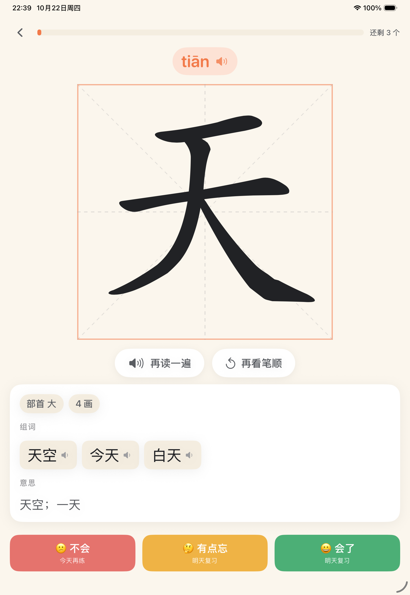
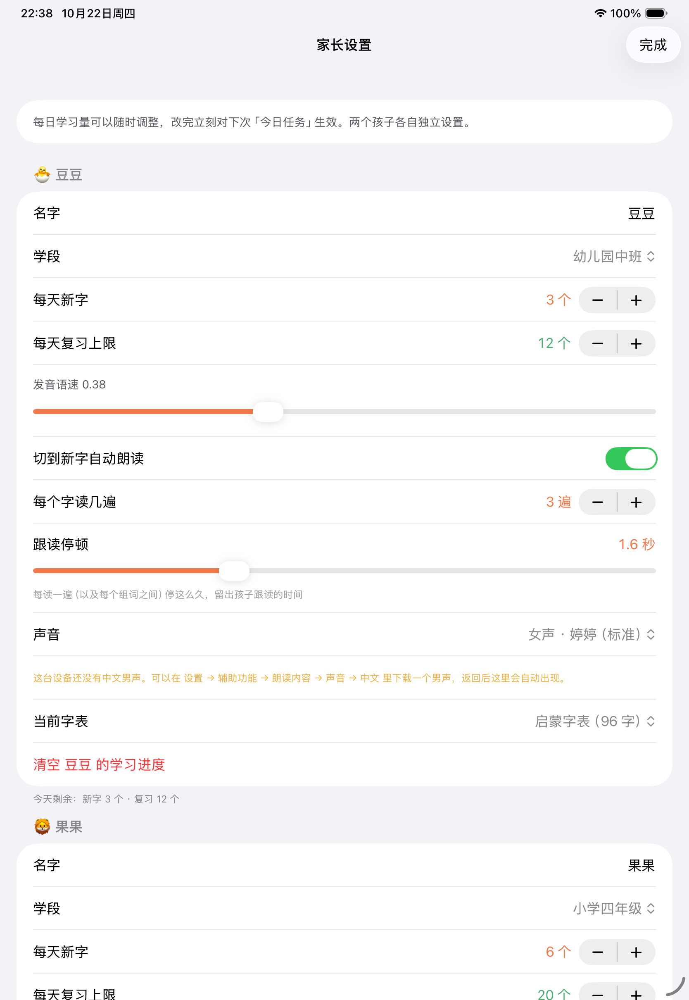
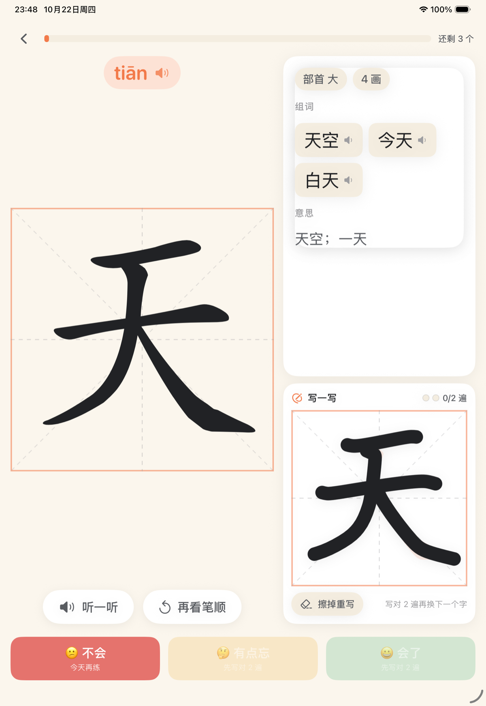
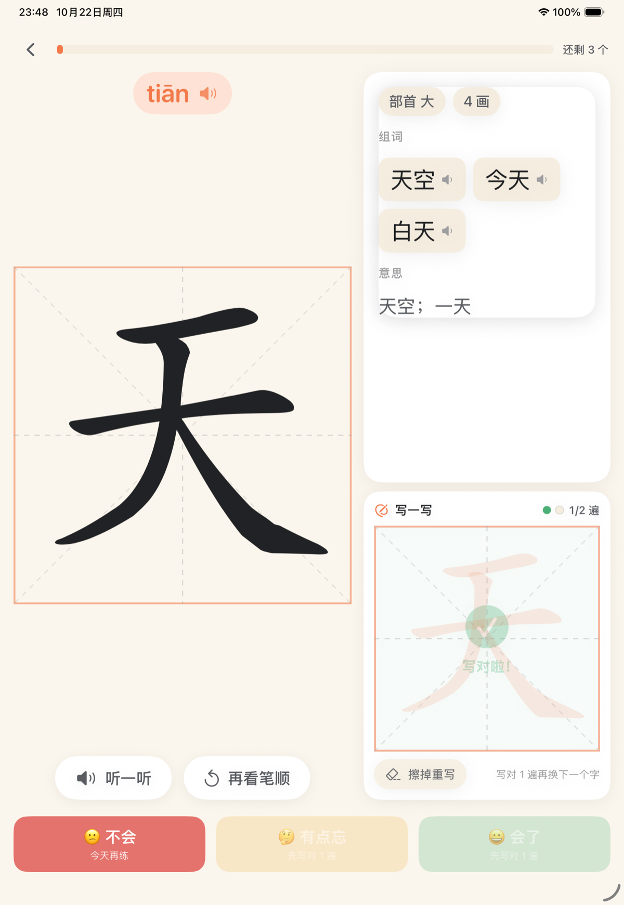
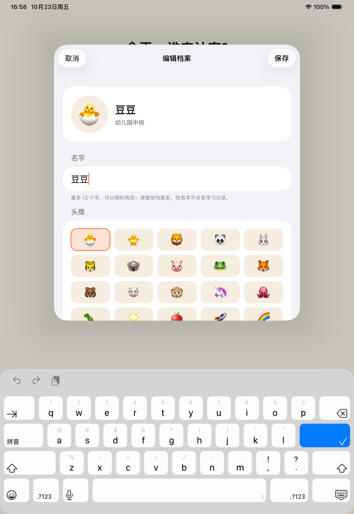
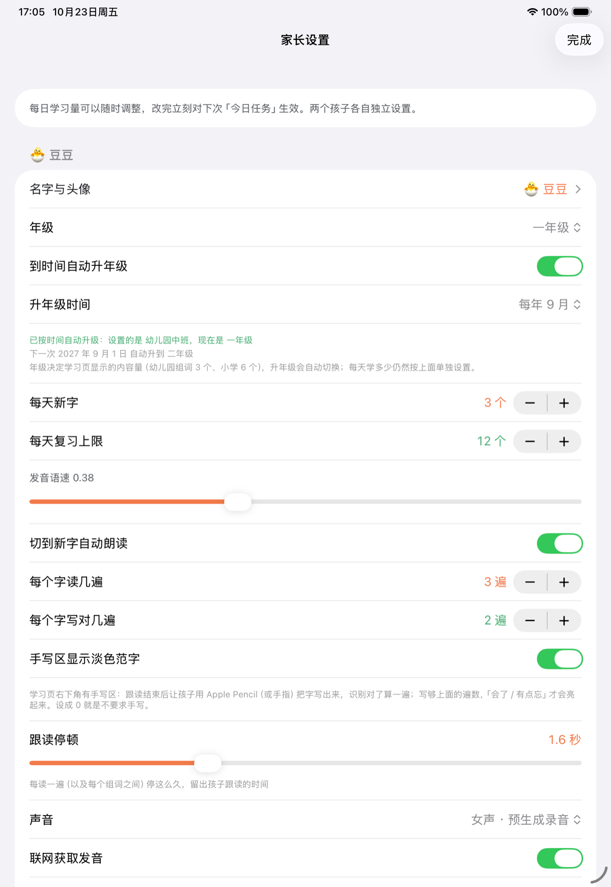
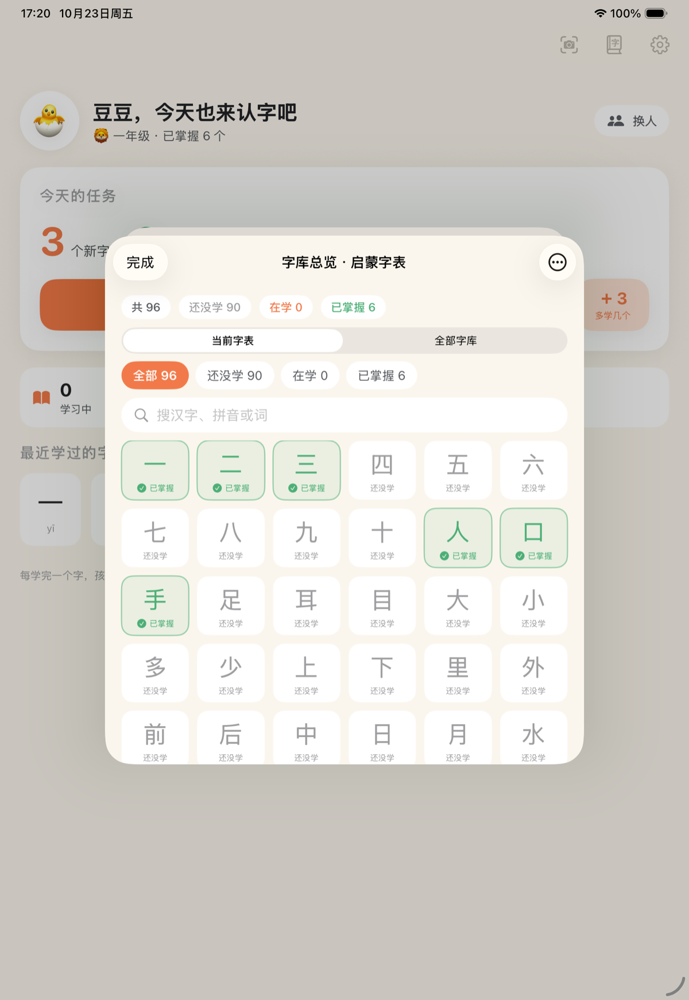

# 认字啦 · HanziKid

给自家孩子做的 **iPad 识字 App**。一页一个字：大字、笔顺动画、发音、组词、释义，读完在右下角**手写**一遍（本地识别），孩子自己点「会了 / 有点忘 / 不会」，系统按记忆曲线（SM-2）安排下次复习。

原生 SwiftUI，**学习时完全离线、无任何第三方依赖**，两个孩子的进度各自独立。最低支持 **iOS 16.0**（iPadOS 16.3 实测目标）。

| 选孩子 | 今日任务 | 学习页 |
|---|---|---|
|  |  |  |

| 拍照录入 | 从相册选图 | 识别确认 | 录完即学 |
|---|---|---|---|
|  |  |  |  |

| 学习页（大字号 + 自动朗读） | 朗读设置 |
|---|---|
|  |  |

| 手写练习（写下这个字） | 写对了才算一遍 |
|---|---|
|  |  |

| 改名字 / 换头像 | 年级与自动升年级 |
|---|---|
|  |  |

| 字库总览（勾掉 / 拉回） |
|---|
|  |

产品设计文档见 [`docs/识字App设计方案.md`](docs/识字App设计方案.md)。

---

## 现在能做什么（M1 + 拍照录入，已跑通）

- **两个档案**：默认「豆豆」（幼儿园中班）/「果果」（四年级），**名字、头像、年级都能改**；字卡内容共享，学习进度和每日量各自独立
- **年级会自己升**：年级可选幼儿园小班…六年级，到每年 9 月 1 日（月份可改）自动升一级
- **今日任务**：到期复习 + 新字交替排列，做完即止（不鼓励刷屏）
- **一页一字**：拼音（点击发音）、米字格 + 逐笔写出的笔顺动画、部首/笔画、组词（点击发音）、释义
- **三档自评**：会了 / 有点忘 / 不会，实时显示「下次什么时候再见」
- **记忆曲线**：SM-2 简化版，间隔上限 60 天、当天重现、leech（重点字）、掌握后毕业
- **每日学习量家长可调**：0–30 个新字 / 0–60 个复习，改完立刻生效；首页还能「今天多学 3 个」临时加量（跨天自动失效）
- **拍照录入**（今日页右上角相机、字库页左上角相机都能进）：拍照 / 相册选图 / 直接粘贴文字 → Vision 离线识别 → 自动切字去重 → 大按钮网格勾选（字表里已有的自动不选）→ 新建或追加字表 → 立刻能学；字库外的字也会建卡（先学字形和笔顺，标「待补全」）
- **字库**：内置 3506 字（3500 常用字 + 课本里出现但字频靠后的 6 字），可搜索、按拼音/笔画/字表排序、加入或移出字表
- **字库总览（新）**：一格一字看进度，**点一下就把完全会的字勾掉**（不再进今日任务），再点一下把忘掉的字拉回学习范围；支持按状态筛选与批量操作
- **课本字表**：内置《部编版一年级上册》299 字、《一年级下册》403 字（按课文顺序）、启蒙字表 96 字、四年级示例 120 字；字表可以指派给任何一个孩子
- **自动跟读（新）**：切到一个字后自动读 3 遍，每遍之间留出可调的「跟读停顿」，再读 3 个组词（词与词之间同样停顿）；遍数、停顿、男声/女声都可按孩子单独设置
- **手写练习（新）**：学习页右下角手写区，跟读完后把字写出来，本地识别对了才算一遍，写够遍数才能换字
- **家长设置**：改名、学段、每日量、语速、切换字表、每字写几遍、清空某个孩子的进度

## 还没做（下一步）

- 复习题型多样化（听音选字、看拼音选字、组词填空、易错字辨析、听写）
- 描红书写判分
- 成语 / 近反义词 / 例句 / 字源（需要内容增强 + 家长校对）
- 报告页、每日提醒、iCloud 同步、贴纸奖励

---

## 构建与运行

需要 Xcode 16+（本机用的是 Xcode 26.6，iOS 26.5 SDK）。**部署目标 iOS 16.0**，编译时即做可用性检查，不会误用 17+ API。

```bash
# 用 Xcode 打开
open HanziKid.xcodeproj      # 选 iPad 模拟器或真机，⌘R

# 或命令行构建（DerivedData 放在项目内，避免写到工作区外）
./Tools/build.sh

# 装到已启动的模拟器并运行
xcrun simctl install booted .build/Build/Products/Debug-iphonesimulator/HanziKid.app
xcrun simctl launch booted com.tangfengjing.hanzikid
```

> **这台机器上的两个环境坑**（脚本里已经处理，换机器可以去掉）：
> 1. Xcode 的宏插件子进程要自己再套一层 `sandbox-exec`，被当前沙箱禁止 → 需要 `OTHER_SWIFT_FLAGS="-disable-sandbox"`，否则 `@Model` 全部编译失败。
> 2. 环境里没有 PTY，`xcodebuild test` 起不了测试宿主 → 用 `./Tools/check_logic.sh` 在 macOS 上跑同一套逻辑断言；在正常机器上仍然可以直接 ⌘U 跑 `HanziKidTests`。

## 版本号与更新日志

- 版本号：`主版本.次版本.修订号`（`MARKETING_VERSION`），build 号：`CFBundleVersion`
- **每次打包前先升版本**，改了什么写进 [`CHANGELOG.md`](CHANGELOG.md)：

```bash
./Tools/bump_version.sh minor   # 加功能：0.4.0 → 0.5.0，build +1（并在 CHANGELOG 顶部插一条待填）
./Tools/bump_version.sh patch   # 修 bug ：0.4.0 → 0.4.1，build +1
./Tools/bump_version.sh build   # 只加 build（内部测试包）
./Tools/package_ipa.sh          # 包名自动带版本：HanziKid-0.5.0(5)-unsigned.ipa
```

- App 里也能核对：家长设置页最下面「关于 → 版本」显示 `0.4.0（build 4）`
- 当前版本见 `CHANGELOG.md` 顶部

## 打包成无签名 IPA

```bash
./Tools/package_ipa.sh
# → dist/HanziKid-<版本>(<build>)-unsigned.ipa（约 4.7 MB，在线发音版；arm64，iPad only，最低 iOS 16.0）
```

产物特征（脚本会打印校验信息，图标已内置，桌面显示为「认字啦」）：

| 项 | 值 |
|---|---|
| Bundle ID | `com.tangfengjing.hanzikid` |
| 版本 | 0.6.0（build 6） |
| 架构 | arm64（真机） |
| 最低系统 | iOS 16.0（16.3 可直接重签安装） |
| 设备族 | 仅 iPad（UIDeviceFamily = 2） |
| 签名 | 完全没有签名（`code object is not signed at all`） |
| 强依赖框架 | Foundation / UIKit / SwiftUI / Vision / AVFAudio / Combine（iOS 16 全都有；Spatial 等新库是弱链接，缺失不影响启动） |
| 大小 | 约 4.6 MB（在线发音版）；离线发音版约 61 MB |

**无签名 IPA 不能直接装进 iPad**，需要先用你自己的 Apple ID 重签一次：

- **Sideloadly / AltStore / ESign / 爱思助手**：把 ipa 拖进去，登录 Apple ID，它会替换签名再装到设备（免费账号签的证书 **7 天过期**，需要重签；付费开发者账号 1 年）
- 装完首次打开要去「设置 → 通用 → VPN 与设备管理」信任证书
- 免费账号还需要在「设置 → 隐私与安全 → 开发者模式」里打开开发者模式（iOS 16+）
- 如果你的 iPad 是支持 TrollStore 的系统版本，也可以直接用它永久安装（不用证书）

因为重签会改 Bundle ID（多数工具默认改），App 的数据是按 Bundle ID 存的，**换工具重签后可能看不到之前的进度**，建议固定用同一个工具 + 同一个 Bundle ID。

## 同步到 GitHub（自动发版）

仓库：<https://github.com/ashoru/HanziKid>（私有）

发版流程就两条命令，推送、tag、上传安装包都会自动做完：

```bash
./Tools/bump_version.sh minor   # 升版本号 + build，CHANGELOG 顶部插入待填条目
# …把 CHANGELOG 里的 TODO 改成实际改动…
./Tools/package_ipa.sh          # 编译 → 打包 IPA → 自动同步 GitHub
```

`Tools/package_ipa.sh` 最后一步会调 `Tools/sync_github.sh`，它做的事（幂等，可重复跑）：

1. 有未提交改动就 commit（说明默认 `release: HanziKid-x.y.z(build)`）
2. 推送 `main`
3. 打版本 tag `vX.Y.Z` 并推送（已存在则跳过）
4. 建/更新 Release，说明自动取 `CHANGELOG.md` 里对应版本那段
5. 把 `dist/HanziKid-<版本>(<build>)-unsigned.ipa` 传到 Release Assets
   （GitHub 的 asset 名不允许括号，会自动规整成 `HanziKid-<版本>-build<build>-unsigned.ipa`，本地文件名不变）

单独用：

```bash
./Tools/sync_github.sh --dry-run          # 只看要做什么
./Tools/sync_github.sh -m "fix: 修 xxx"   # 手动指定提交说明
./Tools/sync_github.sh --no-ipa           # 只同步源码和 tag，不传 IPA
./Tools/sync_github.sh --retag            # 发版后又在同版本补了提交，把 tag 挪到最新提交
SYNC_GITHUB=0 ./Tools/package_ipa.sh      # 这次打包不碰 GitHub
```

**API key（Personal Access Token）放在哪**

- 申请 / 查看：<https://github.com/settings/tokens>（classic，scopes 勾 `repo` + `workflow`）
  细粒度令牌在 <https://github.com/settings/personal-access-tokens/new>（给 `HanziKid` 仓库 `Contents: Read and write`）
- **本机已经存在 macOS 钥匙串里**（服务 `github.com`，账号 `ashoru`），脚本通过 `git credential-osxkeychain` 读取，
  **token 不会写进仓库、`.git/config`、脚本或环境变量文件**
- 想临时换一个：`GH_TOKEN=github_pat_xxx ./Tools/sync_github.sh`（脚本优先用它）
- 换新 token 后同步更新钥匙串：`git credential-osxkeychain erase`（粘贴 `protocol=https` / `host=github.com` 后回车两下），
  下次 push 时输入新 token 即可记住

`.gitignore` 已排除 `dist/`、`Tools/audio/`、`HanziKid/Resources/audio/`，所以仓库里只有源码，IPA 走 Release 附件，不占 git 历史。

## 发音从哪来（重要）

### 默认：在线获取（0.5.0 起）

安装包不再带音频，**运行时按需从百度 TTS 取，落盘缓存**：

- 进入一张字卡 → 自动播报，同时**预取当前字的组词 + 后面两张卡的音频**，切下一张基本无等待
- 每个字/词只下载一次，存在 `Caches/tts/`，之后完全离线可用（学过的字不耗流量）
- 断网/超时自动回退系统 TTS，学习流程不中断
- 家长设置里可关「联网获取发音」、可「清空发音缓存」
- 安装包 4.6 MB（离线版 61 MB）

> 想做成完全离线版（适合 iPad 不常联网的情况）：
> ```bash
> python3 Tools/fetch_audio.py     # 预生成到 Tools/audio/（约 12 分钟）
> ./Tools/make_offline_audio.sh    # 拷进 App 资源目录
> ./Tools/package_ipa.sh           # 打出来的包就是离线版
> ```
> 离线版优先播包内音频，包内没有的（比如拍照新录入的字）仍然走在线 + 缓存。

### 附：预生成音频的细节（离线版 / 缓存源）

**不用系统 TTS 了**：系统读单个汉字只有 0.5 秒左右，又短又急。现在改成**预生成音频打包进 App**：

- 来源：百度翻译的 TTS 接口（`fanyi.baidu.com/gettts`），单字语速慢一档、组词正常语速
- 覆盖：3506 个单字 + 4284 个组词（四个字表里用到的词），全部离线文件，运行时不需要联网
- 单字音频约 1.2–1.3 秒，尾音自然，不再是"半个音节就掐掉"
- 缺音频的字/词（极少数）会自动回退系统 TTS
- 声音设置里：**女声 = 预生成录音**，**男声 = 系统语音**（百度这个接口只给女声；要真·男声录音得换成付费 TTS 服务，可以后续接）

```bash
python3 Tools/fetch_audio.py            # 重新/补抓音频（已存在会跳过）
python3 Tools/fetch_audio.py --only-chars
```

> 这些音频是百度 TTS 生成、仅供家庭自用打包的；如果以后要上架或对外分发，需要换成有授权的 TTS 服务，别直接分发这批文件。

## 手写练习（0.6.0 起）

学习页右下角是手写区（右栏加宽、组词/释义压到上面一条，手写格子约 400pt，手指直接写也够大）：
跟读读完，孩子照着淡色范字（描红）把这个字写出来，**写完自己点「✅ 写好了，看看对不对」才判定**，
认对了才算写了一遍，攒够家长设置的遍数，「😀 会了 / 🤔 有点忘」才会亮起来——也就是不写对就换不了下一个字。

- 判定是**手动触发**的（不会停笔自动判），小朋友写完点按钮，系统才认这一遍
- 没通过会提示「笔画还没写全，再补几笔」或「和范字不太像，擦掉重写一次」，可以补两笔再点一次
- 「擦掉」按钮在判定按钮左边，随时能重写

设置项（家长设置 → 每个孩子）：

| 设置 | 默认 | 说明 |
|---|---|---|
| 每个字写对几遍 | 2 遍 | 0～5；0 = 不要求手写，写不写都能换下一个字 |
| 手写区显示淡色范字 | 开 | 关掉就是凭记忆写（更难，适合已比较熟的字） |

没有 Apple Pencil 也能写（手指直接写），`PKCanvasView` 用的是 `.anyInput`。

### 识别是怎么做的（完全本地，不联网、不上传笔迹）

`HanziKid/Domain/HandwritingMatcher.swift`：

1. 范字用该字的**笔顺中线**（`strokes.json` 里每一笔的 median，已归一化到 0…1）表示
2. 笔迹按 PencilKit 的采样点归一化到同一个 0…1 坐标系
3. 各算「互相有多近」两个分数（阈值 `tau = 0.042`，约等于 32 格网格里的 1.3 格）：
   - `cover`：范字的点有多少落在笔迹附近 → 笔画写全了没有（下限 0.68）
   - `stray`：笔迹的点有多少落在范字附近 → 有没有写成别的字 / 写飞（下限 0.78）
4. 先按包围盒平移对齐、再按包围盒等比缩放对齐各试一次，取分数最高的那个（补偿"写偏了""写小了"）
5. 两个分数都过线才算写对；判定由「写好了」按钮触发（不会边走边判）

字库外的自造字（拍照录入、没有笔顺数据）退回「楷体字模栅格 + 膨胀容差」的粗匹配；连字模都渲染不出来时不做拦截。

阈值是用真实笔顺数据做合成测试标定的（认真描/手抖 100% 通过，整体写偏 100% 通过，写错字 0%、乱画 0%、只点一下 0%）：
`Tools/logic_checks/main.swift` 里的「手写识别」一段，跑 `./Tools/check_logic.sh` 可复现。

## 字库总览：勾掉 / 拉回

入口（任选一个）：

- **今日页右上角「字库总览」按钮**（清单图标）—— 一步直达
- 今日页的「学习中 / 已掌握」统计卡片**可以直接点**（点「已掌握」进去直接筛到已掌握的字）
- 今日页右上角「字库」→ 再点右上角「总览」

- 一个字一格，格子下方写着状态：`还没学` / `在学` / `复习中` / `已掌握`；已掌握的是绿色 + ✓
- **点一下 = 勾掉**：孩子已经完全会了的字，点一下立刻标为「已掌握」，不再出现在今日任务里（再点一下恢复）
- **拉回学习**：对已掌握的字再点一下，就拉回学习范围 —— 当天就会出现在复习任务里，按记忆曲线重新排
- 顶部四个计数：共 / 还没学 / 在学 / 已掌握；筛选条可以只看某一类
- 范围切换：当前字表 / 全部字库；搜索支持汉字、拼音、组词
- 右上角「⋯」批量：把**当前筛选结果**一次性标为已掌握 / 一次性拉回学习（会先确认，并提示影响范围）

> 标记只改该孩子的复习状态（`SRSState`），不动字卡和字表，也不影响另一个孩子；已掌握的字想看回来就在「已掌握」筛选里点一下。

## 年级：自定义 + 按时间自动升

原来的「学段」只有两档（幼儿园中班 / 四年级），现在换成了**年级**：

| 设置 | 默认 | 说明 |
|---|---|---|
| 年级 | 幼儿园中班 / 四年级 | 幼儿园小班、中班、大班、一年级 … 六年级，共 9 档，每个孩子各自设置 |
| 到时间自动升年级 | 开 | 关掉就是固定年级，不会自己变 |
| 升年级时间 | 每年 9 月 | 1–12 月都能选（按中国学年默认 9 月 1 日） |

做法：档案里存的是「**基准年级 + 基准月**」（家长上一次设置时是几年级、属于哪个学年），
每次显示时用当前日期算「跨过了几个升年级日」再加到基准年级上 —— 所以不需要后台任务、也不用等 App 启动时改数据，
跨过 9 月 1 日那天一打开就是新年级。家长手动改年级时会把基准重新锚定到「最近一个升年级日」。

- 设置页会显示 `下一次 2027 年 9 月 1 日 自动升到 二年级`，自动升过之后提示 `已按时间自动升级：设置的是 幼儿园中班，现在是一年级`
- 年级只影响**内容量**（幼儿园组词 3 个 / 小学组词 6 个、小学才显示多音字读音），**每天新字和复习上限不会被动**，避免升年级那天学习量突然翻倍
- 老存档（只有学段字段）按「幼儿园中班 = 中班」「小学四年级 = 四年级」推断，进度不受影响
- 六年级封顶

## 档案：改名字 / 换头像

默认两个档案叫「豆豆」「果果」，都可以改成自家孩子的名字：

- 选人页：每张卡片右上角的**铅笔**按钮 → 改名字（最多 12 字）+ 选头像（20 个预设 emoji，也能自己打一个）
- 家长设置：每个孩子那一节的第一行「名字与头像」→ 同一个编辑页
- 名字留空不能保存；改名字**不影响学习进度**（进度跟着档案 ID 走），另一个孩子也不受影响
- 头像和名字会显示在选人页、今日任务页顶部、家长设置里

## 朗读相关设置（家长设置里，按孩子分别设置）

| 设置 | 默认 | 说明 |
|---|---|---|
| 切到新字自动朗读 | 开 | 进入一个字就自动开始 |
| 每个字读几遍 | 3 遍 | 1–5 遍可调 |
| 跟读停顿 | 中班 1.6 秒 / 四年级 1.2 秒 | 0.5–4.0 秒，作用于「字与字之间」和「词与词之间」 |
| 声音 | 女声（预生成录音） | 女声走预生成音频；男声走系统音色（显示实际音色名，如「婷婷（标准）」） |

顺序是：读字 → 停顿 → 读字 → 停顿 → 读字 → 停顿 → 组词 1 → 停顿 → 组词 2 → 停顿 → 组词 3。

**男声需要在系统里装一个中文男声音色**：iPad 的 设置 → 辅助功能 → 朗读内容 → 声音 → 中文 → 下载一个男声。装好后回到 App，设置页会显示「男声 · XXXX」，那个「没有中文男声」的提示也会消失（模拟器上就是没有男声，所以提示会一直在）。

### 调试用的启动参数（仅 DEBUG）

```bash
xcrun simctl launch booted com.tangfengjing.hanzikid --demo            # 跳过选人，直接进第一个孩子
xcrun simctl launch booted com.tangfengjing.hanzikid --demo --demo-char 树   # 直接进某个字的学习页
xcrun simctl launch booted com.tangfengjing.hanzikid --demo --demo-library   # 直接打开字库
xcrun simctl launch booted com.tangfengjing.hanzikid --demo --demo-settings  # 直接打开家长设置
xcrun simctl launch booted com.tangfengjing.hanzikid --demo --demo-capture-input   # 打开「录新字」首页
xcrun simctl launch booted com.tangfengjing.hanzikid --demo --demo-capture         # 用内置样张跑一次拍照识别
xcrun simctl launch booted com.tangfengjing.hanzikid --demo --demo-capture --demo-confirm  # 识别后自动确认，验证写库
xcrun simctl launch booted com.tangfengjing.hanzikid --demo --demo-capture --demo-text "龘彧春天"  # 验证"待补全"字
xcrun simctl launch booted com.tangfengjing.hanzikid --demo --demo-study --demo-write  # 自动把手写区写满，验证识别→计数→解锁
xcrun simctl launch booted com.tangfengjing.hanzikid --demo-edit-profile  # 直接打开第一个孩子的「改名字/换头像」
xcrun simctl launch booted com.tangfengjing.hanzikid --demo-rename        # 自动改名换头像，验证写盘
xcrun simctl launch booted com.tangfengjing.hanzikid --demo --demo-settings --demo-auto-grade  # 造一个"两年前中班"的档案，验证自动升年级
xcrun simctl launch booted com.tangfengjing.hanzikid --demo --demo-library --demo-overview  # 直接打开字库总览
xcrun simctl launch booted com.tangfengjing.hanzikid --demo --demo-library --demo-overview --demo-mark-some  # 先勾掉 6 个字，看混合状态
```

---

## 目录结构

```
HanziKid/
├─ App/            HanziKidApp.swift（App 入口，注入 AppStore）、RootView
├─ Domain/         Models.swift（数据模型）、Scheduler.swift（SM-2 纯逻辑）、StudySession.swift（排程 + 会话）、
│                  HandwritingMatcher.swift（手写识别：笔迹 vs 笔顺中线）
├─ Services/       BaseLibrary（字库播种）、StrokeLibrary（SVG 笔顺解析）、SpeechService（离线 TTS）、
│                  OCRService（Vision 中文识别）、CardImporter（字卡入库）
├─ Features/
│  ├─ Profile/     选孩子
│  ├─ Today/       今日任务
│  ├─ Study/       学习页 + HanziBoard（米字格 / 逐笔动画）+ HandwritingPad（手写区）
│  ├─ Capture/     拍照录入（选图 / 粘贴 / 勾选确认）
│  ├─ Library/     字库浏览与字表编辑
│  └─ Parent/      家长设置
├─ DesignSystem/   Theme（配色、字体、卡片样式）
└─ Resources/      base_characters.json、strokes.json、decks.json、Assets.xcassets
HanziKidTests/     调度器 / 排程 / 会话 / 手写识别的单元测试（XCTest）
Tools/
├─ build_base_library.py   从开源数据生成内置字库
├─ logic_checks/main.swift 无 PTY 环境下的逻辑断言
├─ build.sh / check_logic.sh / package_ipa.sh  构建 / 逻辑测试 / 打无签名 IPA（打包完自动同步 GitHub）
├─ sync_github.sh                             commit + push + tag + 上传 IPA 到 Releases
├─ bump_version.sh                            升版本号 + build，并在 CHANGELOG 顶部插入条目
├─ make_icon.swift                            生成 1024 图标（改图标跑这个）
└─ raw/                    原始数据（已 gitignore，脚本会自动下载）
```

## 字库是怎么来的

`Tools/build_base_library.py` 把四个开源数据源合成一份离线字库（**当前 3500 常用字**）：

| 内容 | 来源 | 说明 |
|---|---|---|
| 拼音（含多音） | [mozillazg/pinyin-data](https://github.com/mozillazg/pinyin-data) | MIT |
| 部首 / 笔画数 / 释义 | [pwxcoo/chinese-xinhua](https://github.com/pwxcoo/chinese-xinhua) | 仓库声明数据仅供学习研究 |
| 逐笔 SVG + 中线 | [skishore/makemeahanzi](https://github.com/skishore/makemeahanzi) | LGPL-3.0 / Arphic Public License，**如上架 App Store 需先核对授权** |
| 词频（选常用字 + 组词） | [fxsjy/jieba](https://github.com/fxsjy/jieba) | MIT |

```bash
python3 Tools/build_base_library.py --limit 3500   # 重新生成（会自动下载原始数据到 Tools/raw/）
# 课本字表：改 Tools/textbook_characters.json（按课文逐条），再跑上面的命令，decks.json 就会带上新字表
python3 Tools/build_base_library.py --limit 3500 --force   # 强制重新下载原始数据
```

要点：

- 选字 = 词频排序取前 N，再强制带上「一二三…人口手」这类启蒙必备字
- 5 岁启蒙的 96 个字（一二三…水火山…爸妈）有**人工兜底的释义和组词**（`PRESCHOOL_CONTENT`），避免出现「水产」「我军」这种不适合幼儿的词
- 释义会自动压成一句话；`contentHash` 变了 App 启动时就会自动重新导入字卡（复习进度按字保留）

## 记忆曲线参数

`Domain/Scheduler.swift`，可调：

| 参数 | 值 | 说明 |
|---|---|---|
| 首次 / 第二次间隔 | 1 天 / 3 天 | 之后按 间隔 × 难度系数 增长 |
| 间隔上限 | 60 天 | 孩子学字要保持手感 |
| 难度系数 | 2.5，范围 1.3–2.8 | 会了 +0.1、有点忘 −0.15、不会 −0.2 |
| 「不会」 | 10 分钟后重现 | 当天再练一次，明天再来 |
| 已掌握 | 连对 4 次且间隔 ≥ 21 天 | 毕业后不再每日打扰 |
| 重点字（leech） | 错 4 次 | 优先插队复习 |

## 测试

```bash
python3 Tools/fetch_audio.py # 抓发音（首次或换内容后跑一次，约 12 分钟，产物不进 git）
./Tools/check_logic.sh       # 51 项逻辑断言（调度器 / 每日上限 / 排程 / 双档案隔离 / 抽字 / 入库）
./Tools/package_ipa.sh       # 打无签名 IPA
# 或在 Xcode 里 ⌘U 跑 HanziKidTests（同一批用例的 XCTest 版本）
```

## 数据存在哪

- 学习状态 / 字表 / 孩子档案 / 复习日志：`<App 沙盒>/Library/Application Support/HanziKid/state.json`（单个 JSON，原子写入，改动合并后 0.4 秒落盘）
- 内置 3500 字字卡与笔顺：只读，随 App 打包，不写盘
- 卸载 App 会连数据一起删掉；想备份就把上面那个 `state.json` 拷出来

数据层没有用 Core Data / SwiftData（SwiftData 需要 iOS 17）：模型是 `Codable` 值类型 + 内存索引，所以能在 iOS 16 跑，也能直接在 macOS 上跑单元测试。

## 已知限制

- 一年级上册 299 字 / 下册 403 字是**从你拍的课本照片逐页核对转录**的（不是 OCR 直出——生字格上 OCR 错字太多）。书后标注一上 300、下册 400，我转录去重后是 299 / 403，差的那 1~3 个可能是多音字重复或我漏看一行，你翻书对一眼就能确认
- **释义是从字典正文启发式抽取的**：会过滤古文引证，宁可空着（约 1% 无释义），但仍有个别字抽到偏书面/本源义的解释（如「课 → 考核」）。**成语、例句、近反义词还没有**——这块是下一步的内容增强（预生成 + 家长校对）才做得对
- **相机**这一条没法在模拟器上真点（模拟器没有相机硬件）；相册选择器、OCR、勾选、入库、待补全卡都在模拟器上跑过并截了图（见 `docs/screenshots/06~09`），真机上第一次点相机时留意一下权限弹窗即可
- 学习页只在 iPad 竖屏验证过，横屏是自适应布局但未逐项验收
- 本机只有 iOS 26.5 模拟器，**没有 iOS 16 运行时可以实跑**；16.3 兼容性是靠「部署目标 16.0 + 编译期可用性检查 + 强依赖框架清单核对」保证的，真机首次启动请留意是否有异常
- 家长锁（算术门）还没做，目前家长区无保护
- 发音用系统中文 TTS，音色取决于设备是否下载了「增强/高级」语音
