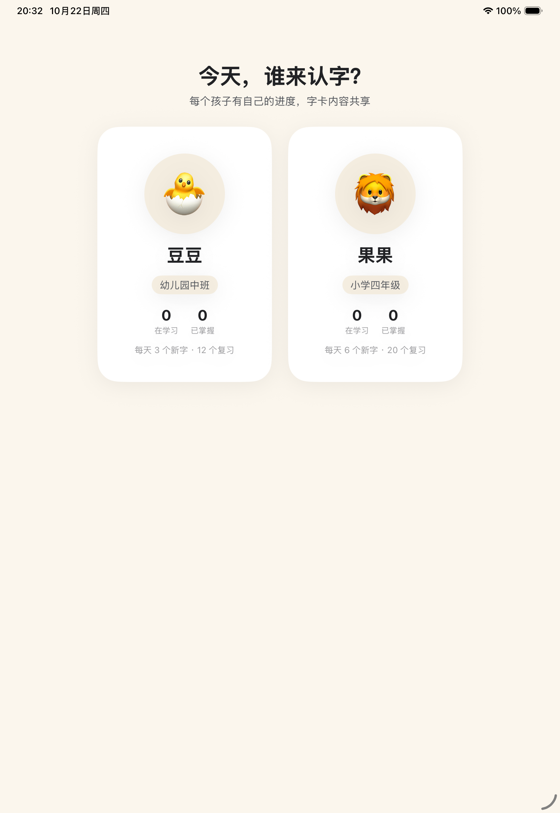
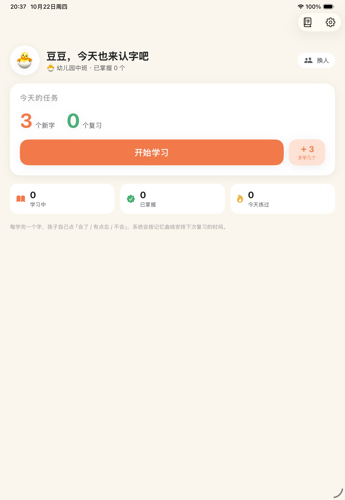
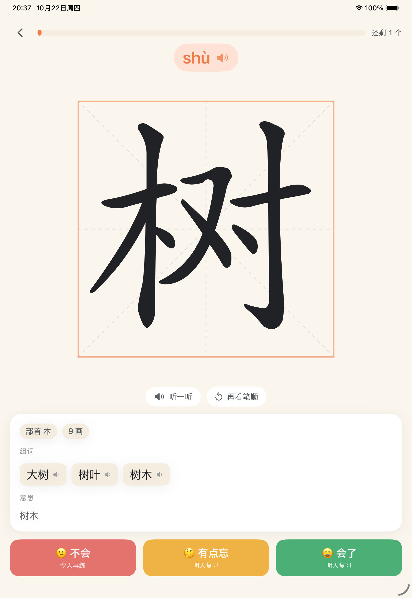
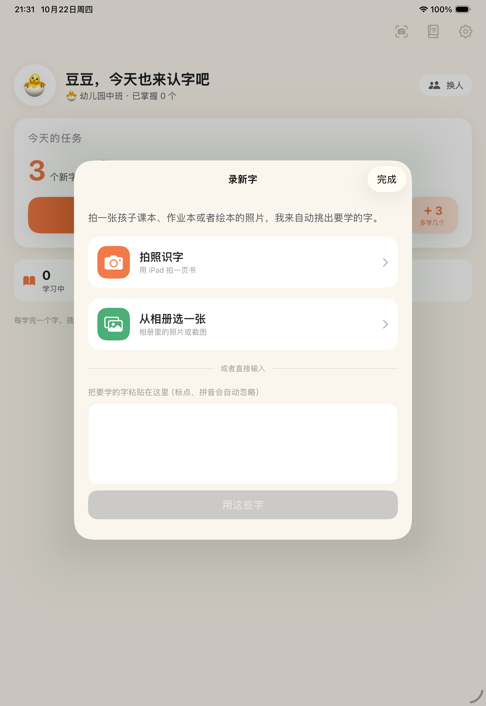
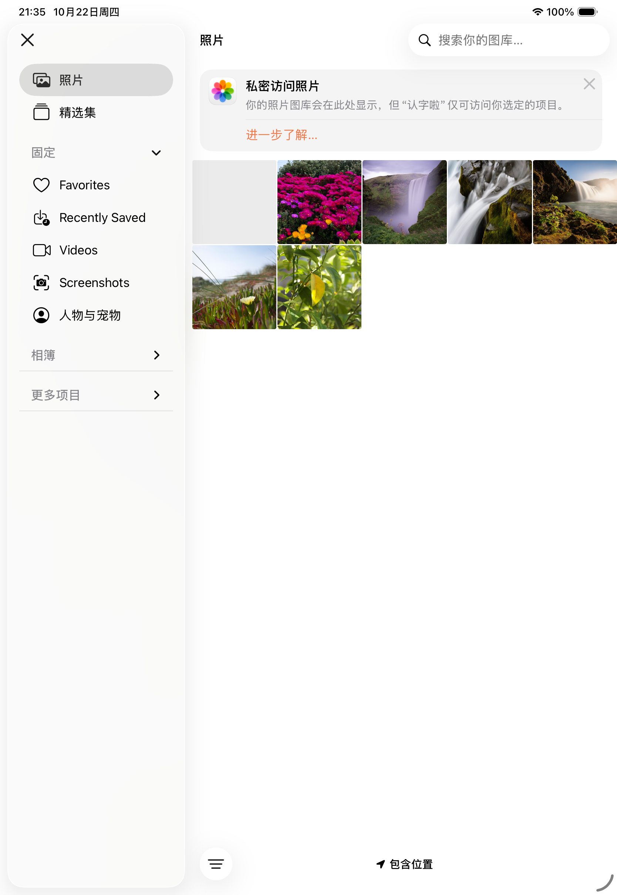
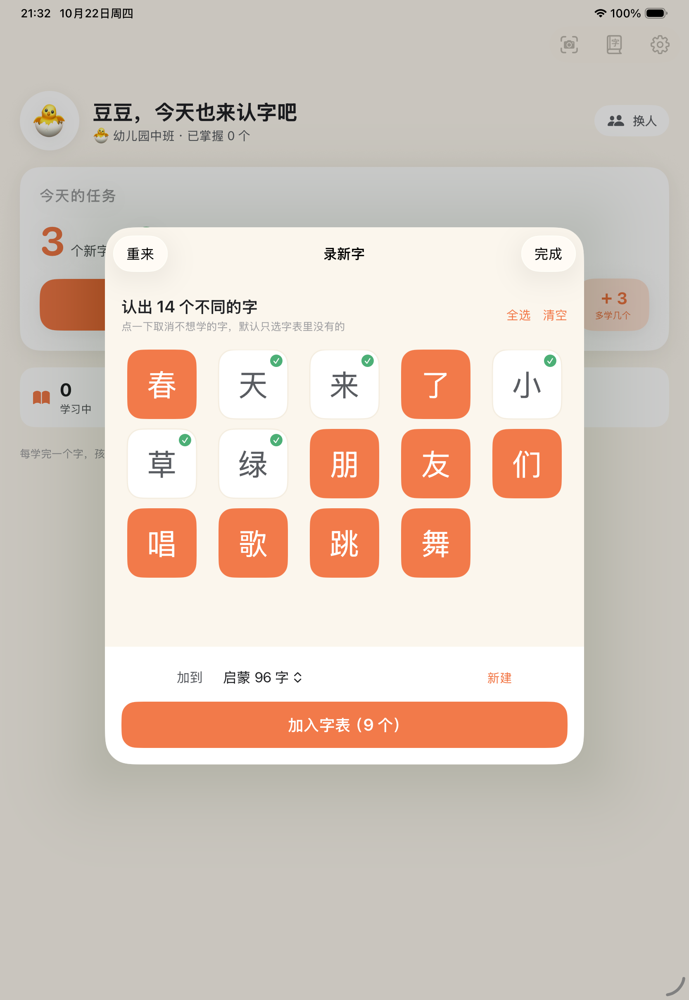
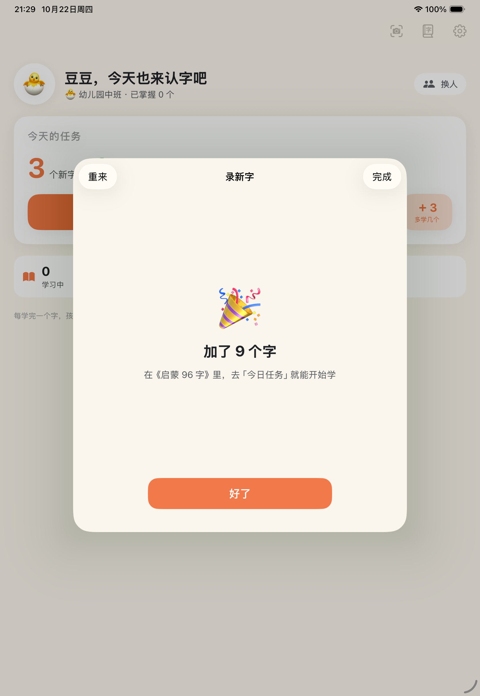

# 认字啦 · HanziKid

给自家孩子做的 **iPad 识字 App**。一页一个字：大字、笔顺动画、发音、组词、释义，孩子自己点「会了 / 有点忘 / 不会」，系统按记忆曲线（SM-2）安排下次复习。

原生 SwiftUI + SwiftData，**学习时完全离线**，两个孩子的进度各自独立。

| 选孩子 | 今日任务 | 学习页 |
|---|---|---|
|  |  |  |

| 拍照录入 | 从相册选图 | 识别确认 | 录完即学 |
|---|---|---|---|
|  |  |  |  |

产品设计文档见 [`docs/识字App设计方案.md`](docs/识字App设计方案.md)。

---

## 现在能做什么（M1 + 拍照录入，已跑通）

- **两个档案**：豆豆（幼儿园中班）/ 果果（小学四年级），字卡内容共享，学习进度和每日量各自独立
- **今日任务**：到期复习 + 新字交替排列，做完即止（不鼓励刷屏）
- **一页一字**：拼音（点击发音）、米字格 + 逐笔写出的笔顺动画、部首/笔画、组词（点击发音）、释义
- **三档自评**：会了 / 有点忘 / 不会，实时显示「下次什么时候再见」
- **记忆曲线**：SM-2 简化版，间隔上限 60 天、当天重现、leech（重点字）、掌握后毕业
- **每日学习量家长可调**：0–30 个新字 / 0–60 个复习，改完立刻生效；首页还能「今天多学 3 个」临时加量（跨天自动失效）
- **拍照录入**（今日页右上角相机、字库页左上角相机都能进）：拍照 / 相册选图 / 直接粘贴文字 → Vision 离线识别 → 自动切字去重 → 大按钮网格勾选（字表里已有的自动不选）→ 新建或追加字表 → 立刻能学；字库外的字也会建卡（先学字形和笔顺，标「待补全」）
- **字库**：内置 3500 常用字（拼音 / 部首 / 笔画 / 释义 / 组词 / 笔顺），可搜索、按拼音/笔画/字表排序、加入或移出字表
- **家长设置**：改名、学段、每日量、语速、切换字表、清空某个孩子的进度

## 还没做（下一步）

- 复习题型多样化（听音选字、看拼音选字、组词填空、易错字辨析、听写）
- 描红书写判分
- 成语 / 近反义词 / 例句 / 字源（需要内容增强 + 家长校对）
- 报告页、每日提醒、iCloud 同步、贴纸奖励

---

## 构建与运行

需要 Xcode 16+（本机用的是 Xcode 26.6，iOS 26.5 SDK，部署目标 iOS 17.0）。

```bash
# 用 Xcode 打开
open HanziKid.xcodeproj      # 选 iPad 模拟器或真机，⌘R

# 或命令行构建（DerivedData 放在项目内，避免写到工作区外）
./Tools/build.sh

# 装到已启动的模拟器并运行
xcrun simctl install booted .build/Build/Products/Debug-iphonesimulator/HanziKid.app
xcrun simctl launch booted com.tangfengjing.hanzikid
```

> **这台机器上的两个环境坑**（脚本里已经处理，换机器可以去掉）：
> 1. Xcode 的宏插件子进程要自己再套一层 `sandbox-exec`，被当前沙箱禁止 → 需要 `OTHER_SWIFT_FLAGS="-disable-sandbox"`，否则 `@Model` 全部编译失败。
> 2. 环境里没有 PTY，`xcodebuild test` 起不了测试宿主 → 用 `./Tools/check_logic.sh` 在 macOS 上跑同一套逻辑断言；在正常机器上仍然可以直接 ⌘U 跑 `HanziKidTests`。

## 打包成无签名 IPA

```bash
./Tools/package_ipa.sh
# → dist/HanziKid-unsigned.ipa（约 4.4 MB，Payload/HanziKid.app，arm64，iPad only，最低 iOS 17）
```

产物特征（脚本会打印校验信息，图标已内置，桌面显示为「认字啦」）：

| 项 | 值 |
|---|---|
| Bundle ID | `com.tangfengjing.hanzikid` |
| 版本 | 0.1（Build 1） |
| 架构 | arm64（真机） |
| 最低系统 | iOS 17.0 |
| 设备族 | 仅 iPad（UIDeviceFamily = 2） |
| 签名 | 完全没有签名（`code object is not signed at all`） |
| 大小 | 约 4.5 MB（12.5 MB 解包，主要是 3500 字的笔顺数据） |

**无签名 IPA 不能直接装进 iPad**，需要先用你自己的 Apple ID 重签一次：

- **Sideloadly / AltStore / ESign / 爱思助手**：把 ipa 拖进去，登录 Apple ID，它会替换签名再装到设备（免费账号签的证书 **7 天过期**，需要重签；付费开发者账号 1 年）
- 装完首次打开要去「设置 → 通用 → VPN 与设备管理」信任证书
- 免费账号还需要在「设置 → 隐私与安全 → 开发者模式」里打开开发者模式（iOS 16+）
- 如果你的 iPad 是支持 TrollStore 的系统版本，也可以直接用它永久安装（不用证书）

因为重签会改 Bundle ID（多数工具默认改），App 的数据是按 Bundle ID 存的，**换工具重签后可能看不到之前的进度**，建议固定用同一个工具 + 同一个 Bundle ID。

### 调试用的启动参数（仅 DEBUG）

```bash
xcrun simctl launch booted com.tangfengjing.hanzikid --demo            # 跳过选人，直接进第一个孩子
xcrun simctl launch booted com.tangfengjing.hanzikid --demo --demo-char 树   # 直接进某个字的学习页
xcrun simctl launch booted com.tangfengjing.hanzikid --demo --demo-library   # 直接打开字库
xcrun simctl launch booted com.tangfengjing.hanzikid --demo --demo-settings  # 直接打开家长设置
xcrun simctl launch booted com.tangfengjing.hanzikid --demo --demo-capture-input   # 打开「录新字」首页
xcrun simctl launch booted com.tangfengjing.hanzikid --demo --demo-capture         # 用内置样张跑一次拍照识别
xcrun simctl launch booted com.tangfengjing.hanzikid --demo --demo-capture --demo-confirm  # 识别后自动确认，验证写库
xcrun simctl launch booted com.tangfengjing.hanzikid --demo --demo-capture --demo-text "龘彧春天"  # 验证"待补全"字
```

---

## 目录结构

```
HanziKid/
├─ App/            HanziKidApp.swift（App 入口 + ModelContainer + 播种）、RootView
├─ Domain/         Models.swift（SwiftData 模型）、Scheduler.swift（SM-2 纯逻辑）、StudySession.swift（排程 + 会话）
├─ Services/       BaseLibrary（字库播种）、StrokeLibrary（SVG 笔顺解析）、SpeechService（离线 TTS）、
│                  OCRService（Vision 中文识别）、CardImporter（字卡入库）
├─ Features/
│  ├─ Profile/     选孩子
│  ├─ Today/       今日任务
│  ├─ Study/       学习页 + HanziBoard（米字格 / 逐笔动画）
│  ├─ Capture/     拍照录入（选图 / 粘贴 / 勾选确认）
│  ├─ Library/     字库浏览与字表编辑
│  └─ Parent/      家长设置
├─ DesignSystem/   Theme（配色、字体、卡片样式）
└─ Resources/      base_characters.json、strokes.json、decks.json、Assets.xcassets
HanziKidTests/     调度器 / 排程 / 会话的单元测试（XCTest）
Tools/
├─ build_base_library.py   从开源数据生成内置字库
├─ logic_checks/main.swift 无 PTY 环境下的逻辑断言
├─ build.sh / check_logic.sh / package_ipa.sh  构建 / 逻辑测试 / 打无签名 IPA
├─ make_icon.swift                            生成 1024 图标（改图标跑这个）
└─ raw/                    原始数据（已 gitignore，脚本会自动下载）
```

## 字库是怎么来的

`Tools/build_base_library.py` 把四个开源数据源合成一份离线字库（**当前 3500 常用字**）：

| 内容 | 来源 | 说明 |
|---|---|---|
| 拼音（含多音） | [mozillazg/pinyin-data](https://github.com/mozillazg/pinyin-data) | MIT |
| 部首 / 笔画数 / 释义 | [pwxcoo/chinese-xinhua](https://github.com/pwxcoo/chinese-xinhua) | 仓库声明数据仅供学习研究 |
| 逐笔 SVG + 中线 | [skishore/makemeahanzi](https://github.com/skishore/makemeahanzi) | LGPL-3.0 / Arphic Public License，**如上架 App Store 需先核对授权** |
| 词频（选常用字 + 组词） | [fxsjy/jieba](https://github.com/fxsjy/jieba) | MIT |

```bash
python3 Tools/build_base_library.py --limit 3500   # 重新生成（会自动下载原始数据到 Tools/raw/）
python3 Tools/build_base_library.py --limit 3500 --force   # 强制重新下载原始数据
```

要点：

- 选字 = 词频排序取前 N，再强制带上「一二三…人口手」这类启蒙必备字
- 5 岁启蒙的 96 个字（一二三…水火山…爸妈）有**人工兜底的释义和组词**（`PRESCHOOL_CONTENT`），避免出现「水产」「我军」这种不适合幼儿的词
- 释义会自动压成一句话；`contentHash` 变了 App 启动时就会自动重新导入字卡（复习进度按字保留）

## 记忆曲线参数

`Domain/Scheduler.swift`，可调：

| 参数 | 值 | 说明 |
|---|---|---|
| 首次 / 第二次间隔 | 1 天 / 3 天 | 之后按 间隔 × 难度系数 增长 |
| 间隔上限 | 60 天 | 孩子学字要保持手感 |
| 难度系数 | 2.5，范围 1.3–2.8 | 会了 +0.1、有点忘 −0.15、不会 −0.2 |
| 「不会」 | 10 分钟后重现 | 当天再练一次，明天再来 |
| 已掌握 | 连对 4 次且间隔 ≥ 21 天 | 毕业后不再每日打扰 |
| 重点字（leech） | 错 4 次 | 优先插队复习 |

## 测试

```bash
./Tools/check_logic.sh       # 39 项逻辑断言（调度器 / 每日上限 / 排程 / 双档案隔离 / 抽字 / 入库）
# 或在 Xcode 里 ⌘U 跑 HanziKidTests（同一批用例的 XCTest 版本）
```

## 已知限制

- **释义是从字典正文启发式抽取的**：会过滤古文引证，宁可空着（约 1% 无释义），但仍有个别字抽到偏书面/本源义的解释（如「课 → 考核」）。**成语、例句、近反义词还没有**——这块是下一步的内容增强（预生成 + 家长校对）才做得对
- **相机**这一条没法在模拟器上真点（模拟器没有相机硬件）；相册选择器、OCR、勾选、入库、待补全卡都在模拟器上跑过并截了图（见 `docs/screenshots/06~09`），真机上第一次点相机时留意一下权限弹窗即可
- 学习页只在 iPad 竖屏验证过，横屏是自适应布局但未逐项验收
- 家长锁（算术门）还没做，目前家长区无保护
- 发音用系统中文 TTS，音色取决于设备是否下载了「增强/高级」语音
